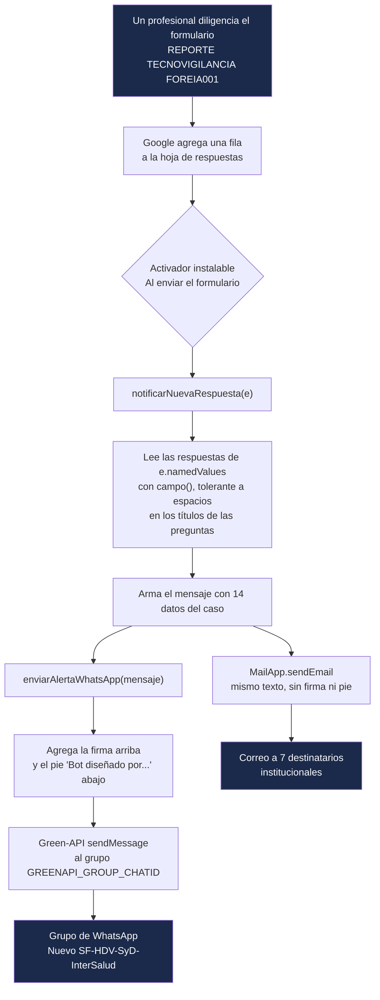

# Alertas WhatsApp - Tecnovigilancia HDV

Bot de Google Apps Script que avisa por **WhatsApp** (vía [Green-API](https://green-api.com/en/)) y por **correo** cada vez que alguien reporta un evento o incidente con un dispositivo médico en el formulario **REPORTE TECNOVIGILANCIA FOREIA001** del Hospital Departamental de Villavicencio E.S.E. (HDV).

| Recurso | Enlace |
|---|---|
| Formulario | [REPORTE TECNOVIGILANCIA FOREIA001](https://docs.google.com/forms/d/1eVJrFKbcnj08AWYu_ZDoApdCmN_V_xdIb3vnglOmQ0M/edit) |
| Hoja de respuestas | [REPORTE TECNOVIGILANCIA FOREIA001 (Respuestas)](https://docs.google.com/spreadsheets/d/1iGua43QTYou2938J-kcfCDhwZtD5m3MtxPtgPt5A9No/edit) |
| Proyecto Apps Script | [Bot Tecnovigilancia](https://script.google.com/u/1/home/projects/1uyZq1KLVHnckyGYKf3gAVgxslze4FRbPiUpQSk8wRy2kkMvcMUa3cpML/edit) (vinculado a la hoja; el código del bot está en el archivo "Sin título") |
| Código en este repo | `WhatsAppAlerts.gs` |

## Cómo funciona



Paso a paso:

1. **Llega un reporte.** Al enviarse el formulario, Google agrega una fila a la hoja de respuestas y dispara el activador instalable "Al enviar el formulario", que llama a `notificarNuevaRespuesta(e)`. No hay ningún proceso por reloj: si nadie reporta, el bot no hace nada.
2. **Se leen los datos.** `e.namedValues` trae cada respuesta con el título exacto de la pregunta. Varios títulos del formulario tienen espacios sobrantes al inicio o al final, así que `campo(nombre)` busca primero el título exacto y, si no lo encuentra, compara sin esos espacios. Si una pregunta viene vacía o no existe, muestra `—`.
3. **Se arma el mensaje** con los datos de la tabla de abajo.
4. **WhatsApp.** `enviarAlertaWhatsApp()` lee las credenciales de Propiedades del script, pone la firma en negrita arriba (`🤖Bot Tecnovigilancia HDV🤖` o lo que diga `GREENAPI_BOT_LABEL`) y el pie en cursiva abajo, y hace un `POST` a `sendMessage` de Green-API hacia el grupo.
5. **Correo.** Después se envía el mismo texto por `MailApp.sendEmail` a los destinatarios fijos del código (dirección técnica y químicos farmacéuticos). El correo no lleva firma ni pie.

> Si la llamada a Green-API lanza una excepción (por ejemplo, sin conexión), la ejecución se detiene y el correo de ese caso no sale. Los errores HTTP (como 466) no detienen la ejecución: quedan en el registro y el correo sí sale.

### Datos del mensaje

| En el mensaje | Pregunta del formulario |
|---|---|
| 👤 Nombre del Reportante | `Nombre del Reportante` |
| 🧑‍⚕️ Profesión | `Profesión` |
| 🏢 Área a la que pertenece | `Área a la que pertenece` |
| 🆔 Identificación del paciente | `Tipo de identificación` + `Número de identificación del paciente` |
| 🛏️ Servicio - Cama del Paciente | `Servicio - Cama del Paciente` |
| 🚻 Sexo / 🎂 Edad | `Sexo`, `Edad` |
| 🩺 Diagnóstico inicial del paciente | `Diagnóstico inicial del paciente` |
| 🔧 Dispositivo médico / 🏭 Fabricante | `Nombre genérico y/o comercial del dispositivo médico`, `Nombre o razón social del fabricante` |
| 🏷️ Clasificación | `Clasificación` |
| 📝 Descripción del evento | `Descripción del evento o incidente adverso` |
| ⚠️ Desenlace del evento | `Desenlace del evento /incidente adverso` |
| 📅 Fecha del evento | `Marca temporal` (fecha y hora de envío del formulario) |

### Ejemplo (datos ficticios)

```
*🤖Bot Tecnovigilancia HDV🤖*

🚨📋 ¡NUEVO CASO DE TECNOVIGILANCIA! 📋🚨

👤 *Nombre del Reportante:* Ana Gómez
🧑‍⚕️ *Profesión:* Enfermera jefe
🏢 *Área a la que pertenece:* UCI adultos
🆔 *Identificación del paciente:* CC 00000000
🛏️ *Servicio - Cama del Paciente:* UCI - Cama 3
🚻 *Sexo:* Femenino   🎂 *Edad:* 45
🩺 *Diagnóstico inicial del paciente:* Sepsis
🔧 *Dispositivo médico:* Bomba de infusión   🏭 *Fabricante:* Fabricante XYZ
🏷️ *Clasificación:* Incidente adverso no serio
📝 *Descripción del evento:* Falla en la alarma de la bomba
⚠️ *Desenlace del evento:* No hubo daño
📅 *Fecha del evento:* 20/10/2026 10:15:00

_Bot diseñado por el QF Juan Pablo Saavedra · Servicio Farmacéutico HDV_
```

## Configuración (Propiedades del script)

En el editor de Apps Script: **Configuración del proyecto → Propiedades del script**. Ninguna credencial va en el código: este repositorio es público.

| Propiedad | Obligatoria | Descripción |
|---|---|---|
| `GREENAPI_ID_INSTANCE` | sí | ID de la instancia de Green-API (compartida con los otros bots) |
| `GREENAPI_API_TOKEN` | sí | Token de la instancia (secreto) |
| `GREENAPI_API_URL` | sí | URL base de la API, ej. `https://7107.api.greenapi.com` |
| `GREENAPI_GROUP_CHATID` | sí | chatId del grupo de destino; siempre termina en `@g.us` |
| `GREENAPI_BOT_LABEL` | no | Firma en negrita al inicio del mensaje (por defecto `🤖Bot Tecnovigilancia HDV🤖`) |

Si falta alguna de las cuatro obligatorias, no se envía el WhatsApp (queda en el registro) y el correo sí sale.

### Grupos

| Grupo | chatId | Uso |
|---|---|---|
| Nuevo SF-HDV-SyD-InterSalud | `120363426937928040@g.us` | **Producción** |
| PRUEBA BOT | `120363412506101174@g.us` | Pruebas |

Para encontrar el chatId de un grupo sin riesgo de enviar nada, ejecutar `listarChatsGreenAPI()`: solo lee (`getChats`) y registra los grupos (`@g.us`) con su nombre.

## Activador

Ya está creado en el proyecto: **Activadores → `notificarNuevaRespuesta` · Desde la hoja de cálculo · Al enviar el formulario**. Debe existir uno solo; si hubiera dos, cada reporte llegaría duplicado.

## Funciones

| Función | ¿Envía algo? | Uso |
|---|---|---|
| `notificarNuevaRespuesta(e)` | Sí (WhatsApp + correo) | La llama el activador. No ejecutarla a mano: sin `e` envía al grupo y por correo un caso con todos los datos en `—` |
| `enviarAlertaWhatsApp(mensaje)` | Sí | Envío a Green-API con firma y pie |
| `listarChatsGreenAPI()` | **No** | Lista los grupos visibles para la instancia |
| `testConstruccionMensaje()` | **No** | Escribe un texto de prueba en el registro |
| `construirMensajeDesdeEvento(evento)` | **No** | Arma un mensaje con el formato anterior de 9 campos; solo lo usa `enviarCasosReales()` |
| `testEnvioWhatsApp()` | Sí | Mensaje fijo de prueba al grupo configurado |
| `enviarEjemploAlGrupo()` | Sí | Caso ficticio al grupo configurado |
| `enviarCasosReales()` | Sí (3 mensajes) | Reenvía 3 casos históricos; ya se usó para validar el formato, no repetir |

Antes de ejecutar cualquier función que envía, confirmar que `GREENAPI_GROUP_CHATID` apunta a PRUEBA BOT.

## Cómo se actualiza el bot

El editor de Apps Script **no** se sincroniza con GitHub. Para cambiar el bot:

1. Hacer el cambio en `WhatsAppAlerts.gs` en este repo y correr las pruebas locales.
2. Copiar el cambio al editor de Apps Script (archivo "Sin título" del proyecto Bot Tecnovigilancia) y guardar con Ctrl+S. No hace falta publicar: el activador usa siempre la última versión guardada.
3. No tocar los archivos `NP05_*` ni `dashboard.html`: son de otro desarrollo que comparte el proyecto.
4. Probar con `GREENAPI_GROUP_CHATID` en PRUEBA BOT antes de volver a producción.

Al pegar texto con tildes o emojis, el editor a veces los daña. Los textos nuevos se escriben con escapes `\u` (como el pie) o con `String.fromCodePoint()`.

## Pruebas locales (sin red ni credenciales)

```bash
node test/dry-run.js     # mensaje, campos ausentes, sin credenciales en el código, solo grupos @g.us
node test/pie-firma.js   # el mensaje enviado termina con el pie de firma
```

Ambas cargan el `.gs` real con Green-API y correo simulados; no envían nada.

## Green-API compartida: cuidado con el cupo de chats

La instancia de Green-API es la misma para los 4 bots del Servicio Farmacéutico y está en el plan Developer (gratis). Ese plan **no limita mensajes, sino chats distintos por mes: 3**, contando los que escriben al número del bot; el contador se reinicia el día 1. Hoy se usan 2 (grupo de producción y PRUEBA BOT). Si se escribe a un cuarto chat, o alguien le escribe por privado al número del bot, Green-API responde 466 y **los 4 bots** dejan de enviar hasta el día 1.

| Bot | Qué lo dispara | Repositorio |
|---|---|---|
| Farmacovigilancia | Formulario FOREAM | [alertas-whatsapp-farmacovigilancia](https://github.com/jsaavedran1-glitch/alertas-whatsapp-farmacovigilancia) |
| Tecnovigilancia | Formulario FOREIA001 | este repositorio |
| PROA antimicrobianos | Formulario de antimicrobianos restringidos | [alertas-whatsapp-antimicrobianos](https://github.com/jsaavedran1-glitch/alertas-whatsapp-antimicrobianos) |
| Alertas INVIMA | Reloj (4 revisiones diarias) | [alertas-whatsapp-sanitarias-invima](https://github.com/jsaavedran1-glitch/alertas-whatsapp-sanitarias-invima) |

## Reglas

- **Solo a grupos.** El destino siempre termina en `@g.us`; nunca se envía a una persona (`@c.us`).
- **Ninguna credencial en el código.** Todo vive en Propiedades del script.
- **No escribir correos de "aclaración" al comité.** Si un dato no se puede mapear con certeza, se usa la pregunta más cercana y se documenta aquí.
- **Si se cambia el texto de una pregunta del formulario**, actualizar el nombre en `campo("...")`; si no, ese dato saldrá como `—` sin ningún error.

## Ver también

`CLAUDE.md` (contexto operativo para asistentes de IA) y `CHANGELOG.md` (historial de cambios).
